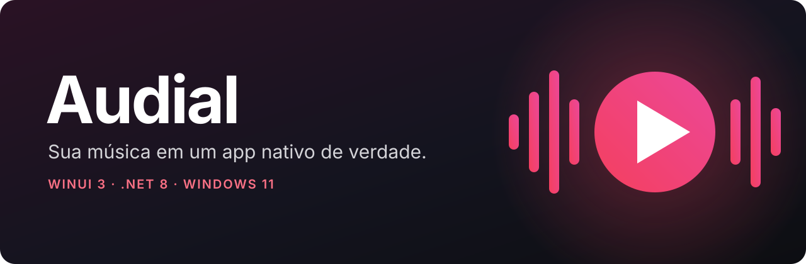
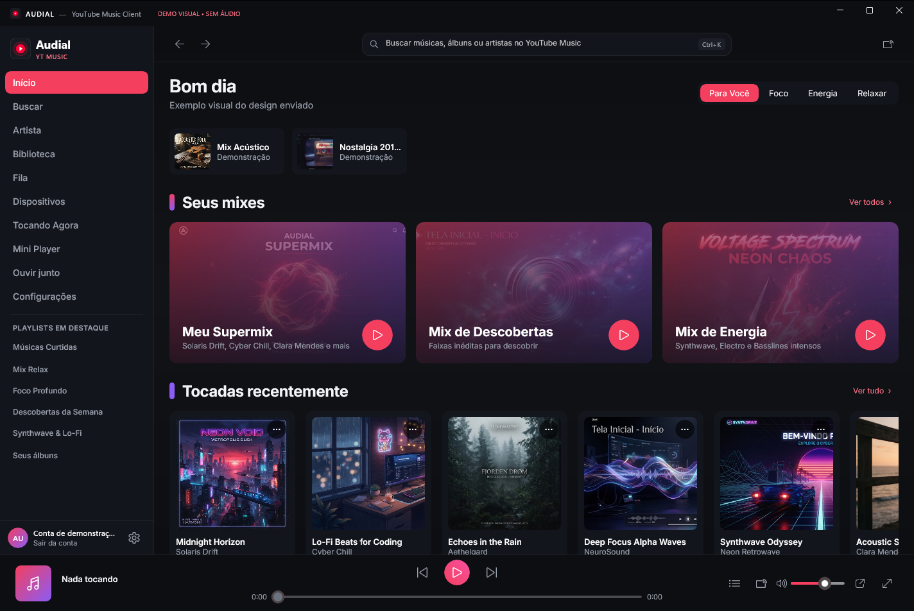
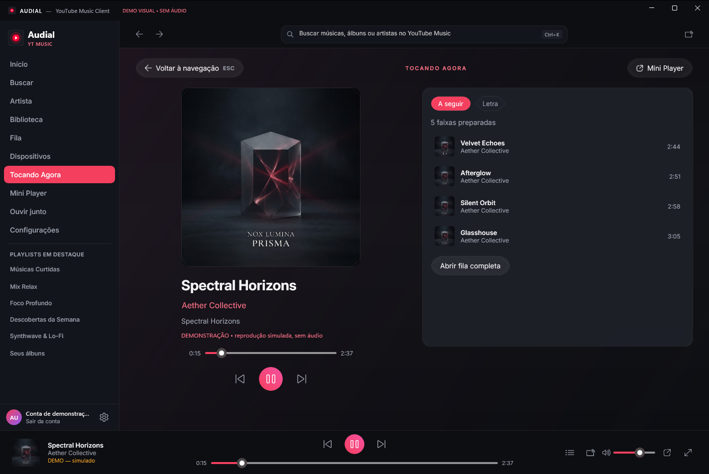
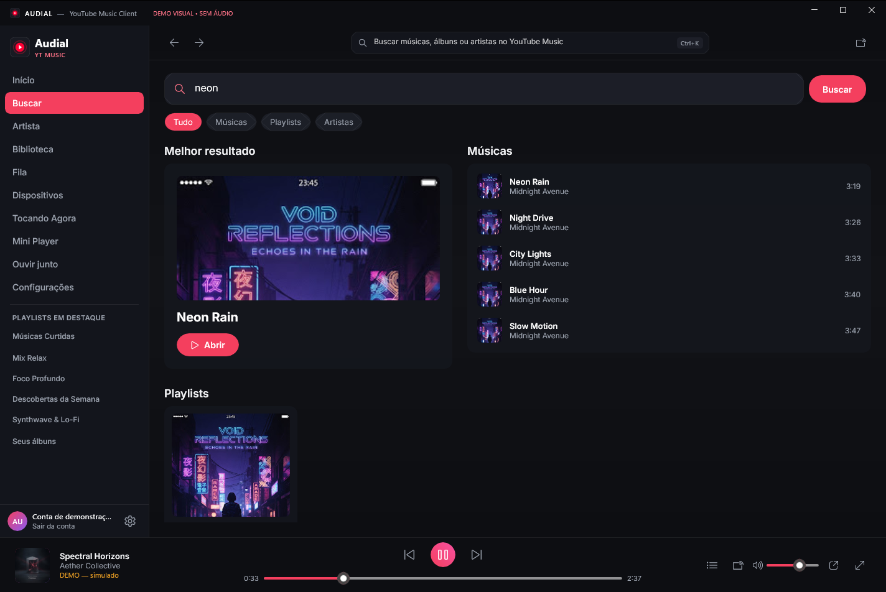
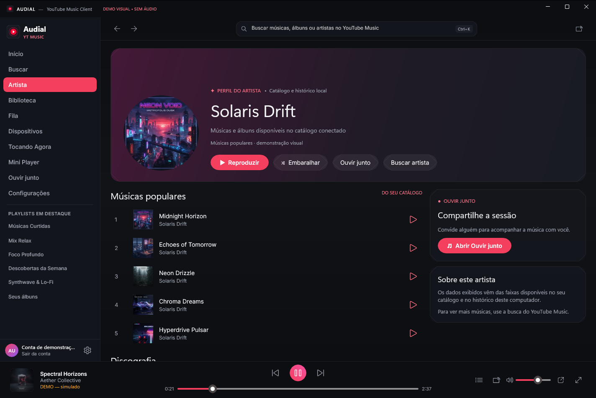
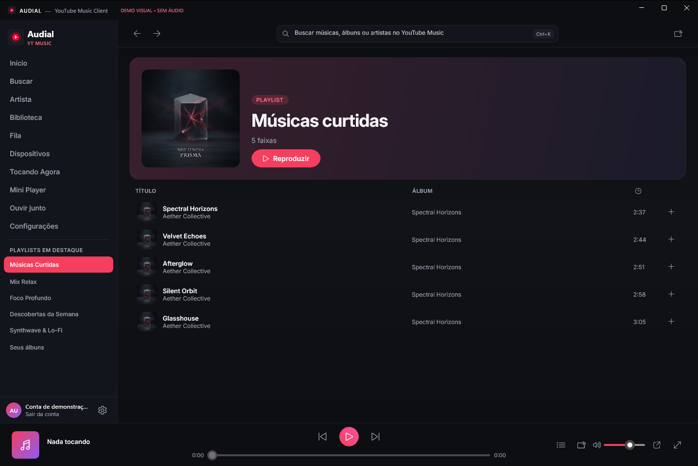
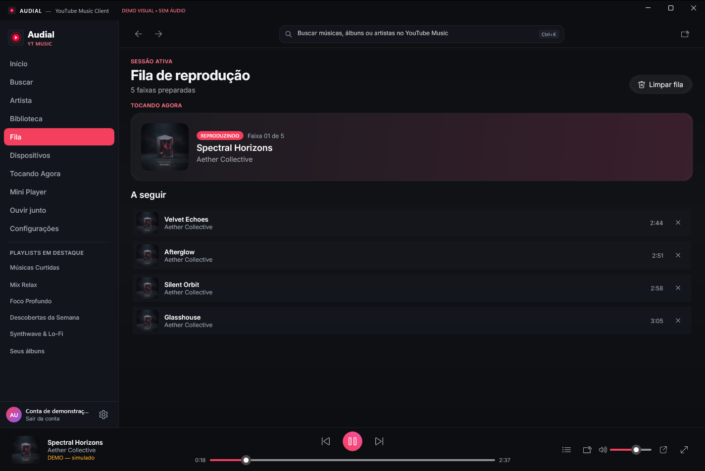
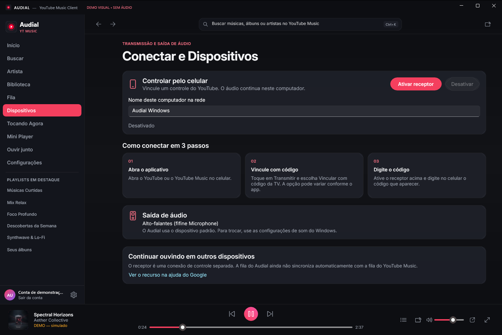
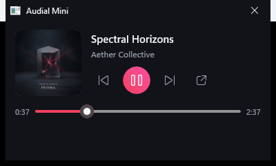
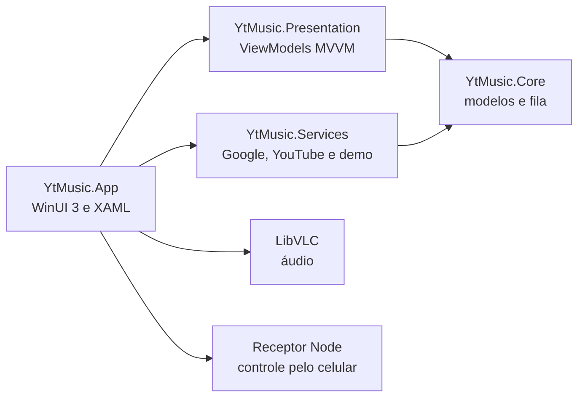

<p align="center">
  
</p>

<p align="center">
  
  
  
  
</p>

<p align="center">
  <b>Um cliente nativo de YouTube Music para Windows, com interface Fluent, mini player e controle pelo celular.</b><br />
  Sem Electron e sem aba de navegador disfarçada de aplicativo.
</p>

<p align="center">
  
</p>

> As imagens usam o modo demonstração, com dados fictícios. O Audial é um projeto independente e não é afiliado ao YouTube ou ao Google.

<p align="center">
  <a href="https://github.com/NightXXT/Audial/releases/latest"></a>
</p>

Baixe o `AudialSetup.exe` e instale uma vez. Depois disso, o próprio app baixa as novas versões publicadas aqui e se atualiza. Como o instalador não tem assinatura digital, o Windows pode mostrar um aviso do SmartScreen.

## Por que o Audial é diferente

- **Nativo de verdade.** Interface em WinUI 3 com efeito Mica, integrada aos controles de mídia do Windows.
- **Sua biblioteca.** Suas playlists e curtidas chegam pela API oficial do YouTube, com login pelo navegador.
- **Controle pelo celular.** Um receptor experimental permite vincular o YouTube do celular por código de TV.
- **Mini Player sempre visível.** Fica sobre as outras janelas, com volume na rodinha do mouse.
- **Modo demonstração.** Dá para explorar toda a interface sem conta e sem áudio.

## Telas

| | |
| --- | --- |
|  |  |
| **Tocando agora**, com fila ao lado | **Busca** em músicas, playlists e artistas |
|  |  |
| **Artista**, com músicas e discografia | **Playlist** com capa e lista de faixas |
|  |  |
| **Fila** de reprodução | **Dispositivos** e pareamento |

<p align="center">
  
</p>

## Recursos

- Início com recomendações, recentes, álbuns e mixes que tocam com um clique
- Busca com filtros de músicas, playlists, artistas e álbuns
- Fila com reprodução, remoção e limpeza
- Reprodução por LibVLC, com busca na faixa e volume
- Atalhos de teclado, como `Ctrl+K`, `Ctrl+Q` e `Ctrl+M`
- Status no Discord, ícone na bandeja e controles de mídia do Windows
- Atualização automática pelos Releases do GitHub, com verificação SHA-256
- Tokens cifrados pelo Windows (DPAPI)

## Como é feito



## Compilar

Você precisa do SDK do .NET 8 e do Windows 10 ou 11 em x64.

Estes itens não ficam no repositório por causa do tamanho e precisam existir antes de compilar:

- `src/YtMusic.App/libvlc/`: plugins nativos do VLC
- `src/YtMusic.App/receiver/node.exe`: runtime do Node para o receptor
- `src/YtMusic.App/receiver/node_modules/`: rode `npm ci` em `src/YtMusic.App/receiver`

```powershell
dotnet build src\YtMusic.App\YtMusic.App.csproj -c Release -p:Platform=x64
```

Para abrir sem conta, use `YtMusicDesktop.exe --demo`. Para gerar o instalador, use o [Inno Setup](https://jrsoftware.org/isinfo.php) com `installer\Audial.iss`.

Para a biblioteca pessoal, você precisa criar o próprio cliente OAuth no Google Cloud. O app explica o passo a passo na tela de login.

## A história

O código original do Audial se perdeu e só sobrou o programa compilado. O projeto foi reconstruído a partir do próprio binário e depois ganhou um visual novo, com ajuda do Claude Code. O processo completo está em [A história da reconstrução](docs/RECONSTRUCAO.md).

## Aviso

O Audial é experimental, usa integrações não oficiais do YouTube Music e pode parar de funcionar se elas mudarem. Ele não confirma benefícios de assinaturas, e o uso deve respeitar os termos do YouTube. As licenças de terceiros estão em [THIRD-PARTY](THIRD-PARTY).
